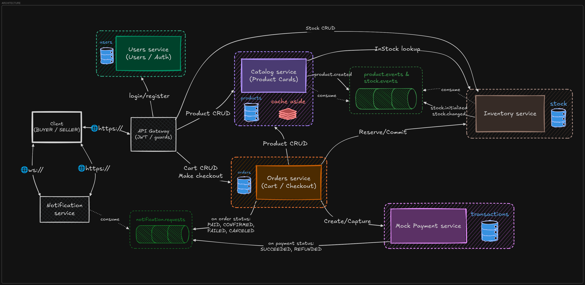

# marketplace

A NestJS marketplace backend: accounts, products, stock, carts, and checkout.
Seven services, separate databases, no shared transaction across an order.

TypeScript · NestJS · PostgreSQL · Drizzle · gRPC · Kafka · Redis · Socket.IO

## services

| service | owns |
| --- | --- |
| API gateway | REST API, JWT validation, routing |
| Users | accounts, authentication, refresh sessions |
| Catalog | products, categories, search, stock read model |
| Inventory | stock, reservations, reservation expiry |
| Orders | cart, orders, checkout saga |
| Payment | payment records, capture, refunds |
| Notification | stored notifications, HTTP and real-time delivery |

gRPC for service calls, Kafka for background events. Each domain service owns
its PostgreSQL database; the gateway has none.

## architecture



[Flow diagrams and notes](doc/README.md) · [Excalidraw source](doc/diagrams.excalidraw)

## highlights

- **Recoverable checkout.** Orders coordinates stock reservation and payment,
  with persisted progress, retries, and compensation after failures.
- **Safe retries.** Transactional outbox for event publication, inbox deduplication
  for event-driven writes, idempotency keys for checkout and payment operations.
- **Stock ownership.** Inventory is the source of truth. Catalog maintains an
  event-driven stock view and uses Redis cache-aside for product reads.
- **Notifications that persist.** Socket.IO for live updates, HTTP for fetching
  missed notifications after reconnecting.

Payment uses a mock provider. See [checkout and recovery](doc/README.md#checkout-saga)
for the flow and current coordination limits.

## local setup

Docker with Compose is enough to run the full stack from the repository root:

```bash
docker compose -f infra/docker/compose.yml build
docker compose -f infra/docker/compose.yml up -d
```

Compose includes infrastructure, database migrations, and all seven services.
REST API: `http://localhost:3000`. Notifications: `http://localhost:3001`.
Uses development credentials, not a production configuration.

For host development and Kubernetes setup, see [infra/README.md](infra/README.md).

## development

Node.js 24 + Bun. Install with Bun to apply the KafkaJS patch in `patches/`.

```bash
bun install --frozen-lockfile
bun run build
bun run lint
bun run test
bun run test:e2e    # Docker required; starts PostgreSQL via Testcontainers
```
