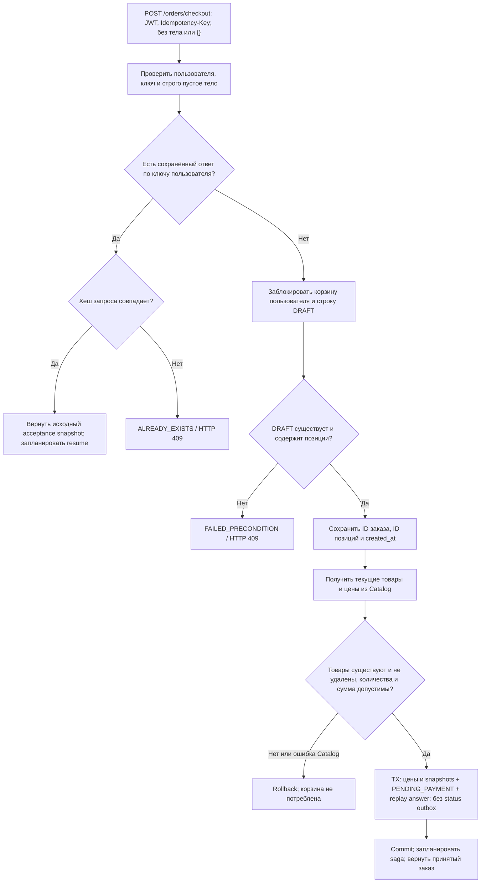
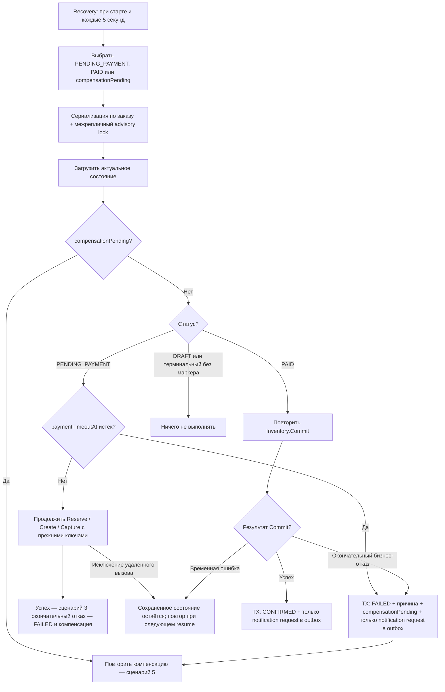
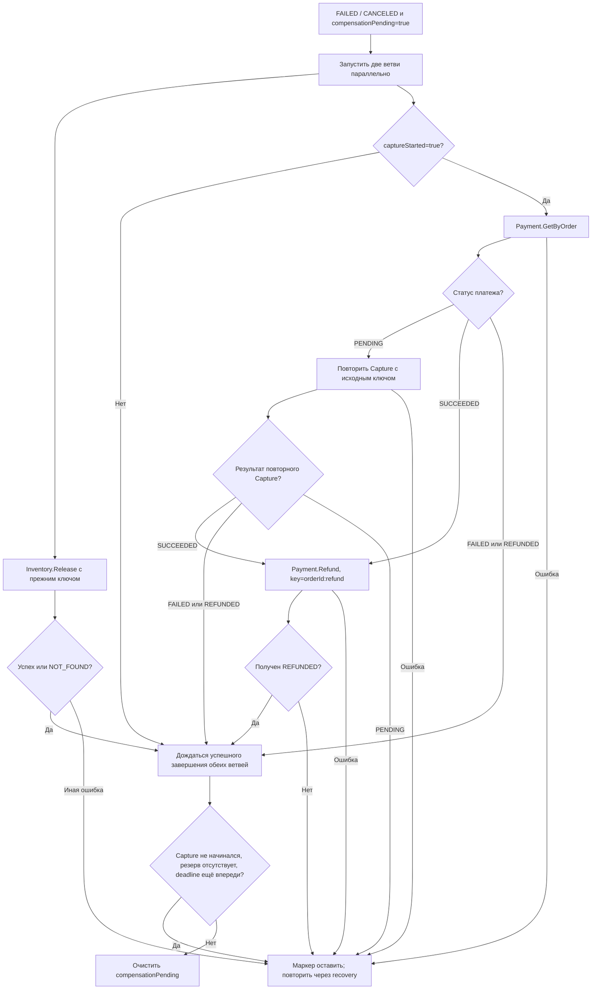
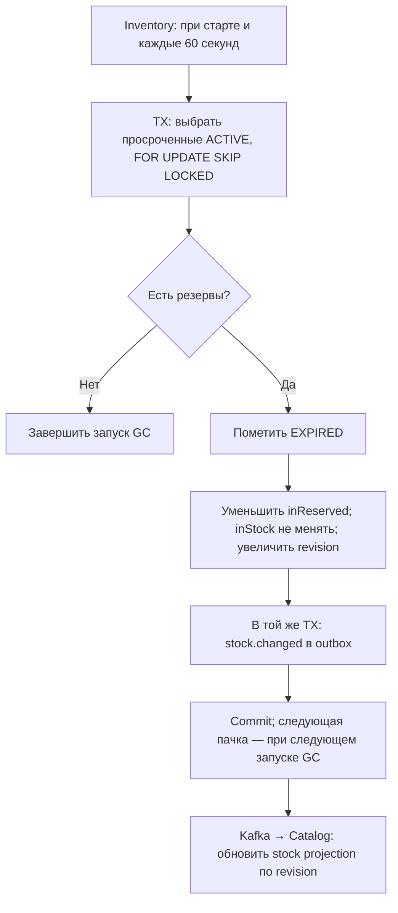

# Основные бизнес-сценарии

## 1. Продавец создаёт товар → склад и проекция обновляются асинхронно

```mermaid
sequenceDiagram
    actor Seller
    participant G as API Gateway
    participant C as Catalog
    participant K as Kafka / outbox relay
    participant I as Inventory
    Seller->>G: POST /products + JWT seller
    G->>C: CreateProduct(initialStock, idempotencyKey)
    C->>C: TX: товар + product.created в outbox
    C-->>G: Созданный товар с productId
    G-->>Seller: Созданный товар
    Note over C,I: Товар уже публичный; ответ не ждёт создания остатков
    C-->>K: product.events: product.created
    K->>I: Доставка события
    I->>I: TX: inbox + stock, если отсутствует + stock.initialized в outbox
    I-->>K: stock.events: stock.initialized
    K->>C: Доставка события
    C->>C: TX: inbox + stock projection
    Note over C: Публичные чтения товаров и поиск исключают soft-deleted товары
```

- Товар доступен публично сразу после создания, до инициализации склада.
  У товара нет status и переходов DRAFT/ACTIVE/ARCHIVED; удаление — через deletedAt.
- До синхронизации stock projection может отсутствовать. Публикация товара не
  гарантирует готовность склада: фактическую доступность проверяет Inventory при Reserve.
- Повторная инициализация не сбрасывает существующие остатки. Ревизии защищают
  Catalog от старых событий; поздняя инициализация не откатывает свежий баланс.
- При непустом ключе тот же запрос возвращает текущее состояние существующего
  товара, включая изменения и soft-delete; другой запрос с тем же ключом конфликтует.
- Публичный товар может отсутствовать в наличии: начальный stock может быть 0.

Код: [создание товара](../apps/catalog-service/src/application/catalog.commands.ts),
[инициализация остатков](../apps/inventory-service/src/application/inventory.service.ts),
[проекция остатков — `CatalogCommands.syncStock`](../apps/catalog-service/src/application/catalog.commands.ts).

### Где читать Catalog

- gRPC-запрос → `catalog.controller.ts` → `CatalogCommands` / `CatalogQueries`.
  Контроллер разбирает metadata, проверяет транспортные поля и собирает ответ.
- Запись товара → `catalog.commands.ts` → `catalog.persistence.ts` →
  `catalog.repository.ts`. Commands описывает сценарий; persistence сохраняет
  агрегат, категории и outbox в одной транзакции; repository содержит SQL.
- Событие склада → `catalog.consumer.ts` → `CatalogCommands.syncStock` →
  та же persistence-транзакция. Inbox и проекция коммитятся вместе; получение
  stock.initialized / stock.changed не управляет видимостью товара.
- `catalog.schema.ts` — таблицы и ограничения; `catalog.mapper.ts` — protobuf
  представление ответа, а не дополнительный шаг исполнения сценария.

## 2. Корзина → принятие заказа на оформление

Корзина — существующий DRAFT-заказ. Добавление товара проверяет, что он существует и не удалён,
но не резервирует склад. Количество можно менять или удалять позицию; цены и
итог в БД остаются NULL до checkout.

`POST /orders/checkout` требует JWT и `Idempotency-Key`, принимает запрос без тела
или строго `{}`. Поле `items`, включая `[]`, и любые другие поля запрещены.
Gateway вызывает `OrdersService.Checkout(CheckoutRequest)` только с
`idempotency_key`; пользователь определяется по доверенным metadata.
Checkout оформляет только серверную корзину этого пользователя; её изменения —
отдельные операции, прямого оформления переданных позиций нет.



При checkout корзины её ID становится ID оформленного заказа. После этого
GetCart возвращает пустую корзину; следующий AddToCart создаёт новый DRAFT.
Повтор старого checkout-ключа не читает цены заново и не потребляет новую корзину.
Replay проверяется по пользователю и ключу до чтения корзины; хеш тела не нужен.
Ответ checkout — принятие заказа, не обещание уже завершённой оплаты.
После принятия цены зафиксированы; последующие изменения Catalog их не меняют.

Код: [корзина и цены](../apps/orders-service/src/application/orders.service.ts),
[транзакция, locks и replay](../apps/orders-service/src/infrastructure/order.repository.ts).

## 3. Успешное оформление: резерв → оплата → списание

```mermaid
sequenceDiagram
    participant O as Orders / CheckoutProcess
    participant D as Orders DB
    participant I as Inventory
    participant P as Payment, mock provider
    Note over O,D: Заказ уже принят: PENDING_PAYMENT
    O->>I: Reserve(orderId, items, key=orderId:reserve)
    I->>I: TX: увеличить inReserved + резервы ACTIVE + replay + outbox
    I-->>O: Snapshots резервов
    O->>P: Create(orderId, userId, total, key=create:orderId)
    P->>P: TX: единственный платёж + attempt + replay; без outbox
    Note over P: При терминальном отказе Create возможен notification request в outbox
    O->>D: Сохранить captureStarted=true
    O->>P: Capture(orderId, key=orderId:capture)
    P-->>O: SUCCEEDED
    O->>D: TX: PAID; без status outbox
    O->>I: Commit(orderId, key=orderId:reserve)
    I->>I: TX: ACTIVE → COMMITTED, уменьшить inStock и inReserved, replay + outbox
    I-->>O: COMMITTED snapshots
    O->>D: TX: CONFIRMED + только notification request в outbox
```

Saga вызывается через gRPC, не управляется ответными Kafka-событиями Payment.
Ключи Reserve, Commit и Release разделены по операциям, поэтому одинаковая строка
`orderId:reserve` безопасна. Платёж один на заказ даже после FAILED/REFUNDED;
новая покупка требует нового заказа. Платёжный провайдер пока синхронный mock.

Код: [saga](../apps/orders-service/src/application/checkout.process.ts),
[gRPC и ключи](../apps/orders-service/src/infrastructure/downstream.grpc.ts),
[платёж и replay](../apps/payment-service/src/application/payment.service.ts).

## 4. Перезапуск, таймаут и ошибка фиксации склада



- Бизнес-отказ Reserve переводит заказ в FAILED и запускает компенсацию.
  Возвращённый Capture статус, отличный от SUCCEEDED, также запускает этот путь.
- Исключения Payment.Create/Capture не означают автоматического FAILED:
  сохранённое состояние обрабатывает recovery; таймаут проверяется для PENDING_PAYMENT.
- PAID с временной ошибкой Commit остаётся PAID. При окончательном отказе Commit
  разрешён PAID → FAILED с возвратом платежа и освобождением активных резервов.
- Отмена доступна только для DRAFT/PENDING_PAYMENT. Отменённый DRAFT остаётся без
  цены, без компенсации; отмена PENDING_PAYMENT сохраняет цены и запускает сценарий 5.

Код: [recovery scheduler](../apps/orders-service/src/infrastructure/recovery.scheduler.ts),
[ветви resume](../apps/orders-service/src/application/checkout.process.ts),
[разрешённые переходы](../apps/orders-service/src/domain/order.ts).

## 5. Компенсация и неопределённый результат Capture

После фиксации FAILED или отмены PENDING_PAYMENT компенсация помечена в БД.
Release и сверка платежа выполняются параллельно. Терминальный статус заказа
ещё не означает, что возврат платежа уже завершён.



Если повтор Capture снова возвращает PENDING, текущая попытка заканчивается с
сохранённым маркером, а не бесконечным опросом: следующая попытка будет в recovery.
В диаграмме статусы показаны после Orders gRPC-адаптера: PROCESSING из Payment
он сейчас нормализует в PENDING; сам mock этот статус не создаёт.
`captureStarted` сохраняется до удалённого Capture: потерянный ответ не позволяет
ошибочно считать, что оплаты не было. Для mock повтор с тем же ключом возвращает
сохранённый результат; успешная оплата затем возвращается через Refund.
Release меняет только ACTIVE-резервы и никогда не возвращает уже списанный товар.
Обычный refund здесь не означает возврат товара покупателем на склад.

Код: [compensate](../apps/orders-service/src/application/checkout.process.ts),
[платёжные повторы](../apps/payment-service/src/application/payment.service.ts),
[финализация резервов](../apps/inventory-service/src/application/inventory.service.ts).

## 6. Истечение срока резервов на складе



Commit сам проверяет TTL и не ждёт GC. Если хотя бы один резерв нельзя списать,
операция откатывается целиком. GC не переводит заказ в FAILED напрямую — состояние
заказа независимо проверяет Orders recovery. Сохранённый ответ Reserve может всё
ещё содержать исходный ACTIVE: replay не является проверкой актуальности резерва.

Код: [expiry scheduler](../apps/inventory-service/src/infrastructure/expiry.scheduler.ts),
[атомарное освобождение и Commit](../apps/inventory-service/src/infrastructure/persistence/inventory.repository.ts).

## 7. Уведомление владельцу и восстановление после reconnect

```mermaid
sequenceDiagram
    actor User as Пользователь
    participant S as Orders / Payment
    participant K as Kafka / outbox relay
    participant N as Notification
    participant D as Notification DB
    participant W as Socket.IO + Redis adapter
    User->>W: Подключиться с access JWT
    W->>W: Проверить JWT и добавить в room владельца
    Note over W: Невалидный JWT — отключение
    S->>S: TX: терминальный статус + notification.requested в outbox
    S-->>K: notification.requests
    K->>N: Событие с event_id
    N->>D: TX: inbox + уведомление с уникальным sourceEventId
    D-->>N: Commit
    N->>D: Найти сохранённое уведомление по event_id
    D-->>N: Уведомление и сохранённый userId
    N->>W: Отправить в room сохранённого владельца
    W-->>User: notification: deliveryId + notification
    N-->>K: Завершить handler после push; KafkaJS подтверждает offset
    opt Клиент пропустил push или переподключился
        User->>N: GET /notifications с JWT
        N->>D: Прочитать только уведомления этого пользователя
        N-->>User: Сохранённые уведомления
    end
    User->>N: PATCH /notifications/:id/read с JWT
    N->>D: Пометить своим пользователем как прочитанное
```

Push может повториться с тем же deliveryId; клиенту нужна дедупликация. Отправка
в socket не является подтверждением получения и не отмечает уведомление прочитанным.
Orders отправляет уведомления для CONFIRMED/FAILED/CANCELED, Payment — для
SUCCEEDED/FAILED/REFUNDED. Промежуточные статусы заказа и платежа — внутреннее
состояние, не Kafka-факты и не push владельцу. Подписки на изменения stock ещё не реализованы.

Код: [consumer и persisted ownership](../apps/notification-service/src/notification.consumer.ts),
[JWT rooms](../apps/notification-service/src/notification.gateway.ts),
[HTTP recovery](../apps/notification-service/src/notification.controller.ts).

## Транспортные границы

- Checkout оркестрируется Orders через gRPC-вызовы Inventory и Payment;
  продолжение и восстановление опираются на сохранённое состояние, не Kafka-события.
- Kafka используется только для `product.events`, `stock.events` и
  `notification.requests` (без собственной retry/DLQ-подсистемы). Неиспользуемые потоки фактов
  `order.events` и `payment.events` не провиженятся и не публикуются.
- Checkout сохраняет PENDING_PAYMENT, а успешная оплата — PAID без status outbox.
  Payment.Create сохраняет платёж, attempt и replay без outbox; при терминальном
  отказе возможен только запрос уведомления. Транзакции CONFIRMED/FAILED сохраняют
  в outbox только notification request, не факт смены статуса.

## Общие гарантии и границы

- Запись бизнес-состояния и outbox — одна локальная транзакция. Между сервисами
  нет общей транзакции; Kafka доставляет как минимум один раз, consumers используют inbox.
- Consumers — NestJS-контроллеры с `@EventPattern`; Kafka transport управляет
  подпиской, offsets и shutdown. Группы остаются `inventory`, `catalog` и
  `notification` без стандартного Nest-суффикса `-server`.
- KafkaJS автоматически подтверждает обработанные сообщения после завершения
  handler: транзакция, затем post-commit push для Notification. Ошибка выходит
  в KafkaJS без подтверждения сообщения; после перезапуска consumer оно доступно
  повторно. Inbox пропускает повторную бизнес-операцию, но post-commit push
  выполняется снова. Битое событие может блокировать партицию: retry/DLQ пока не реализованы.
- Обработчики должны укладываться в Kafka session timeout; собственного heartbeat
  loop нет. Health проверяет доступность брокера, не состояние consumer.
- Топики создаются `kafka-init-topics` в Docker Compose / Kubernetes до запуска
  приложений; приложения не создают топики самостоятельно.
- Внутренние gRPC-вызовы доверяют приватной сети/metadata; диаграммы не подразумевают
  отдельную проверку JWT между каждым сервисом.
- Реальный платёжный провайдер, stock subscriptions и Kafka-driven saga здесь не
  нарисованы как готовые функции. Наличие диаграммы не доказывает успешный deployment
  или завершение отказных экспериментов E1–E3.
