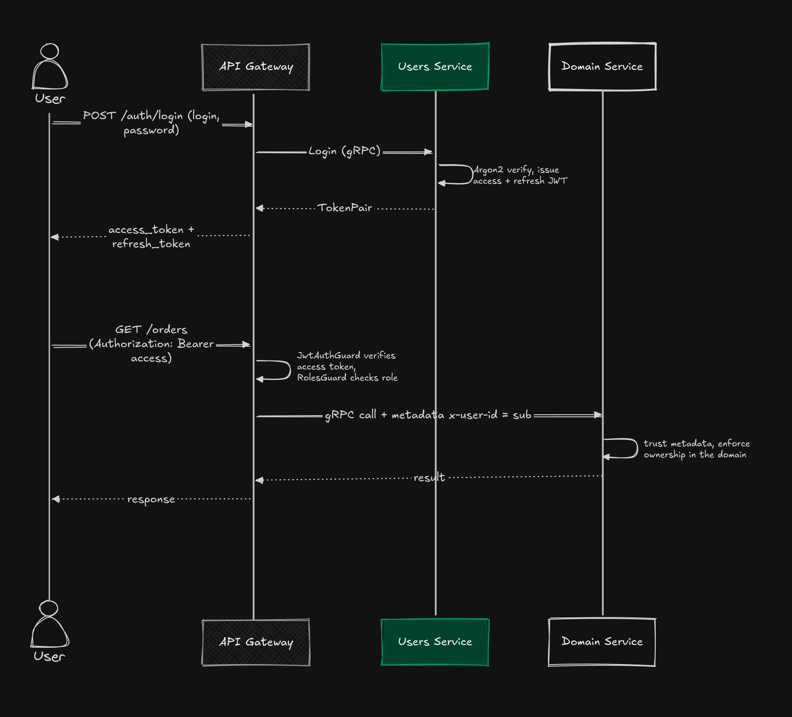
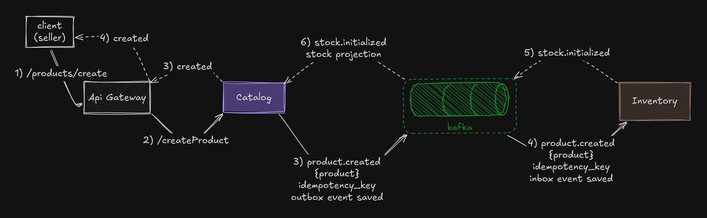
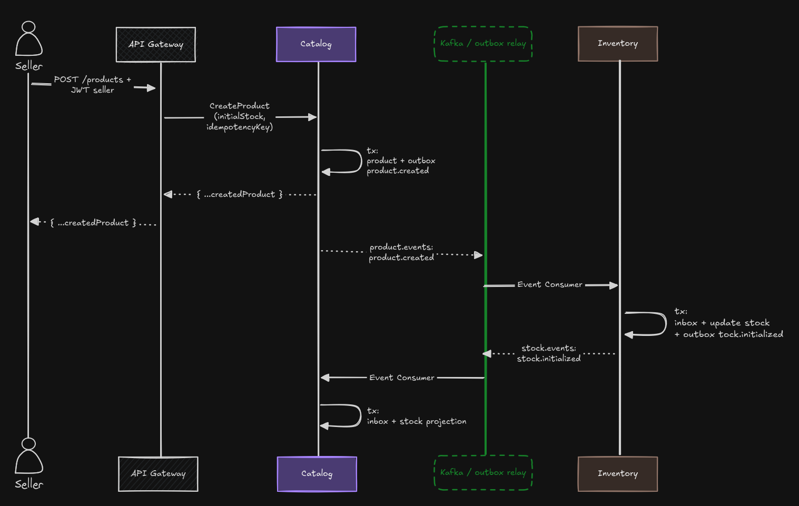
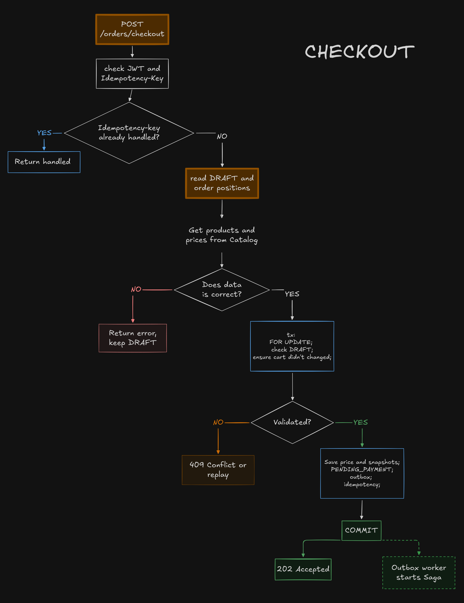
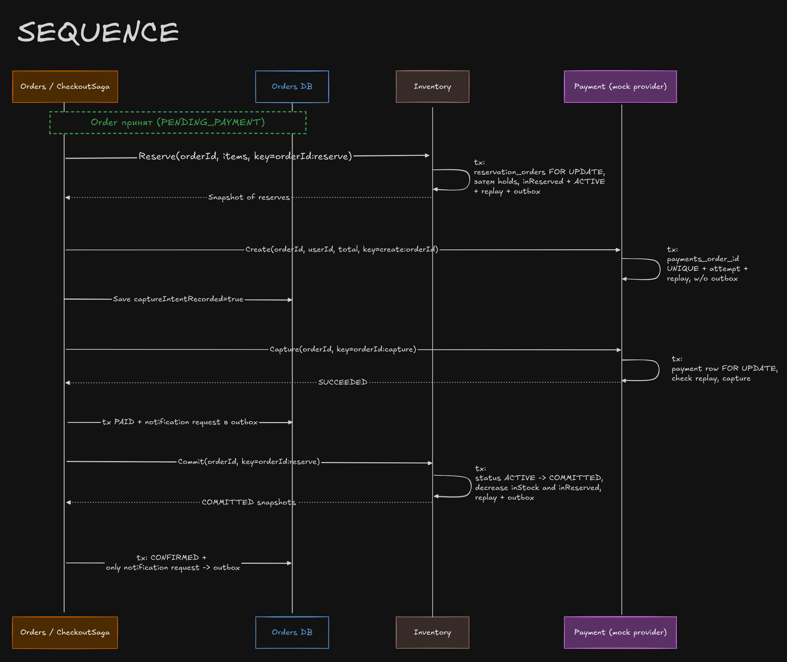
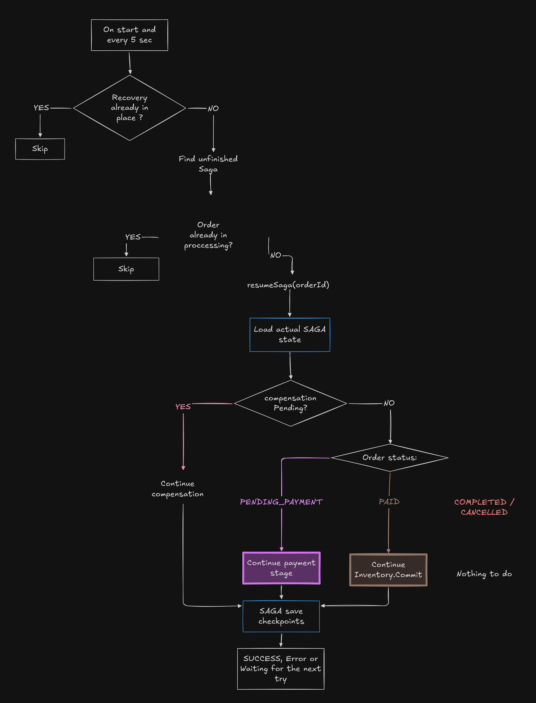

# Схемы процессов

[Обзор проекта](../README.ru.md) · [Исходники схем](diagrams.excalidraw) · [Описание на английском](README.md)

## Авторизация

Сервис пользователей проверяет пароль с Argon2 и выдаёт access- и refresh-токены. API Gateway проверяет access-токен и роль, затем передаёт идентификатор пользователя внутреннему сервису через gRPC metadata. Доменные сервисы отдельно проверяют права владения ресурсом; gRPC-интерфейсы сервисов должны быть доступны только внутри системы.

## Создание товара

Каталог сохраняет товар и событие `product.created` в outbox в одной транзакции. Ответ не ждёт, пока склад создаст начальный остаток. Сервис склада обрабатывает событие, инициализирует остаток и публикует `stock.initialized`; каталог обновляет свою проекцию остатков. Inbox предотвращает повторное применение событий, поэтому товар может появиться в каталоге раньше, чем обновится информация о наличии.

## Оформление заказа

### Принятие заказа

Корзина хранится как заказ в статусе `DRAFT`. Сервис заказов получает цены из каталога, блокирует корзину и проверяет, что её содержимое не изменилось. В одной транзакции он сохраняет снимки позиций, статус `PENDING_PAYMENT`, событие checkout в outbox и ответ для идемпотентного повтора. Клиент получает подтверждение принятия запроса, а не подтверждение оплаты.

На схеме указан ответ `202 Accepted`; текущий HTTP-обработчик возвращает стандартный для NestJS `201`.

### Обработка

Outbox relay публикует событие в Kafka, consumer запускает процесс оформления. Сервис заказов последовательно вызывает по gRPC:

**резервирование остатков → создание и списание платежа → сохранение `PAID` → подтверждение резерва на складе → `CONFIRMED`.**

Намерение списать деньги сохраняется до вызова платежа — это ещё не подтверждение успешной оплаты. Стабильные ключи идемпотентности позволяют безопасно повторить запрос, если ответ потерялся.

### Восстановление после сбоя

Восстановление запускается при старте сервиса и затем каждые пять секунд; уже обрабатываемые заказы пропускаются. Сервис загружает сохранённое состояние и продолжает оплату, повторяет подтверждение резерва или завершает компенсацию. Временные ошибки можно повторить. Бизнес-ошибки и таймауты приводят к освобождению резерва и сверке или возврату платежа.

Успешный финальный статус — `CONFIRMED` (на схеме обозначен как `COMPLETED`). Статусы `FAILED` и `CANCELED` считаются завершёнными только после компенсации. Платёжный провайдер имитируется. Координация саги хранится в памяти процесса, поэтому для нескольких экземпляров сервиса заказов потребуется распределённая координация.
